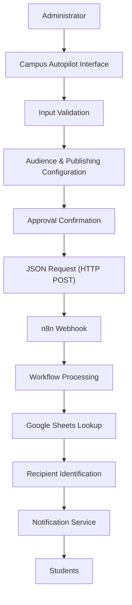
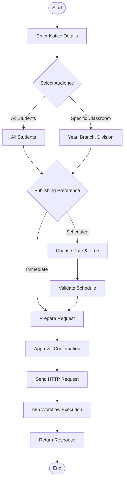
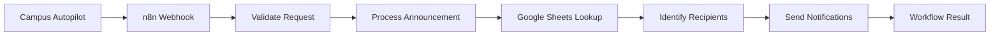

<a id="top"></a>

<div align="center">

# Campus Autopilot

### Intelligent Campus Communication & Automation Platform

*Automating campus communication. Simplifying administration.*

<br/>

[


](https://atharva1118.github.io/campus-autopilot-ui/)
[


](https://github.com/Atharva1118/campus-autopilot-ui)


<br/>

A centralized campus announcement interface that connects notice management with workflow automation, so the **right update reaches the right students at the right time.**

</div>

---

<div align="center">

## Table of Contents

*Click any button to jump to that section.*

| | | |
|:--:|:--:|:--:|
| [


](#overview) | [


](#live-demo) | [


](#problem-statement) |
| [


](#features) | [


](#how-to-use) | [


](#tech-stack) |
| [


](#architecture) | [


](#application-workflow) | [


](#project-structure) |
| [


](#getting-started) | [


](#deployment) | [


](#n8n-integration) |
| [


](#api-reference) | [


](#security-notes) | [


](#roadmap) |
| [


](#contributing) | [


](#author) | |

</div>

---

## Overview

**Campus Autopilot** is a web-based platform that simplifies how educational institutions create, manage, and distribute announcements.

In most colleges, notices travel through disconnected channels such as messaging groups, notice boards, emails, and word of mouth. The result is repeated manual work, delayed updates, and difficulty reaching a specific class or branch.

Campus Autopilot replaces this with a single notice-upload workspace:

1. An administrator **writes a notice**.
2. Chooses the **audience** (the whole college or one specific classroom).
3. Chooses to **publish now or schedule** for later.
4. Gives a **final approval**.
5. The app sends a structured JSON request to an **n8n webhook**, which handles recipient lookup (for example from Google Sheets) and delivery through the configured channels.

The frontend is intentionally lightweight: plain HTML, CSS, and JavaScript with no framework and no build step. Delivery logic lives in n8n, so the same interface can drive email, messaging, or other integrations without frontend changes.

### Objectives

- Centralize campus announcement creation
- Reduce repetitive administrative communication
- Enable audience segmentation by year, branch, and division
- Support immediate and scheduled publishing
- Add an approval checkpoint before notices reach real students
- Connect the frontend to automation workflows through webhooks
- Provide a foundation for scalable campus communication

<p align="right"><a href="#top">⬆ Back to top</a></p>

---

## Live Demo

The application is deployed on GitHub Pages:

> **https://atharva1118.github.io/campus-autopilot-ui/**

> [!NOTE]
> The demo is a static frontend. To deliver notices, paste your own n8n webhook URL into the **Automation connection** panel. Without a webhook configured, nothing is sent anywhere. Use a test workflow while experimenting.

<p align="right"><a href="#top">⬆ Back to top</a></p>

---

## Problem Statement

Institutions constantly share academic updates, event announcements, exam schedules, placement information, and urgent notices. Conventional methods cause several problems:

| Challenge | Impact |
|:--|:--|
| Manual notice distribution | Repetitive administrative work |
| Multiple communication channels | Fragmented information |
| No audience segmentation | Students receive irrelevant announcements |
| Manual scheduling | Extra coordination effort |
| No centralized management | Difficult notice tracking |
| No approval checkpoint | Risk of sending incorrect notices |

**Our approach:** one interface with configurable audience targeting, optional scheduling, an explicit approval step, and a structured automation workflow.

<p align="right"><a href="#top">⬆ Back to top</a></p>

---

## Features

### Notice Creation

- Title field with a **120-character** limit and live counter
- Message field with a **5,000-character** limit and live counter
- Multi-paragraph message support
- Required-field validation before submission
- **Live preview card** showing the title, message, and selected audience as you type

### Audience Targeting

| Option | Description |
|:--|:--|
| **All Students** | Sends to every student in the college |
| **Specific Classroom** | Targets a year, branch, and division |

Academic year options: **First Year (FY)**, **Second Year (SY)**, **Third Year (TY)**, **Fourth Year (Final Year)**. Branch and division selections depend on the chosen year.

### Flexible Publishing

- **Immediate:** leave the schedule empty
- **Scheduled:** choose both a date and a time
- Validation that date and time are provided together

### Final Approval Safeguard

- Required checkbox: *"I approve this notice for production delivery"*
- Warning that production mode can email real student addresses
- Status indicator that stays **Pending** until approved

### Workflow Automation

- n8n webhook integration over HTTP POST
- JSON data exchange
- Configurable webhook URL, saved in the browser
- Response feedback in the interface

### Student Data Integration

Google Sheets can be connected through n8n to retrieve student records and identify recipients matching the selected audience.

<p align="right"><a href="#top">⬆ Back to top</a></p>

---

## How to Use

| Step | Action |
|:--:|:--|
| **1** | Open the [live demo](https://atharva1118.github.io/campus-autopilot-ui/). |
| **2** | In **Automation connection**, paste your n8n production webhook URL and click **Save connection**. |
| **3** | **Notice details:** enter a title and message and watch the live preview. |
| **4** | **Audience:** choose *All Students*, or *Specific Classroom* with year, branch, and division. |
| **5** | **Schedule:** leave empty to publish now, or set both date and time. |
| **6** | **Approval:** review everything and tick the approval checkbox. |
| **7** | Click **Publish notice**. The request goes to your webhook and the workflow controls delivery. |

Use **Clear form** to reset the interface at any time.

<p align="right"><a href="#top">⬆ Back to top</a></p>

---

## Tech Stack

| Technology | Role |
|:--|:--|
| HTML5 | Frontend structure |
| CSS3 | Styling and responsive layout |
| JavaScript (Vanilla) | Application logic and validation |
| n8n | Workflow automation |
| Google Sheets | Student data source |
| Webhooks | Frontend-to-workflow communication |
| JSON | Data exchange format |
| GitHub Pages | Static hosting |
| Git & GitHub | Version control |

### Why these choices

- **Vanilla JavaScript:** lightweight, with no framework or build step, ideal for static hosting.
- **n8n:** visual automation for connecting external services.
- **Google Sheets:** an easily editable student data source.
- **GitHub Pages:** free static hosting deployed straight from the repository.

<p align="right"><a href="#top">⬆ Back to top</a></p>

---

## Architecture

The frontend collects, validates, and forwards data. Recipient lookup and delivery are handled by n8n.



| Component | Responsibility |
|:--|:--|
| Administrator | Creates, configures, and approves announcements |
| Frontend | Collects and validates input, shows the live preview |
| Webhook | Transfers structured data |
| n8n | Executes the configured automation |
| Google Sheets | Provides student records |
| Notification Service | Handles distribution (for example email) |

### Data Flow

1. The administrator writes a notice.
2. The frontend validates input and updates the preview.
3. Audience and schedule preferences are set.
4. The administrator approves the notice.
5. The app sends a JSON request to the webhook.
6. n8n receives and processes the announcement.
7. Student records are retrieved from Google Sheets.
8. Notification integrations handle delivery.

> [!NOTE]
> Actual recipient identification and delivery depend on the deployed n8n workflow.

<p align="right"><a href="#top">⬆ Back to top</a></p>

---

## Application Workflow



<p align="right"><a href="#top">⬆ Back to top</a></p>

---

## Project Structure

```text
campus-autopilot-ui/
├── index.html    # Main application interface
├── style.css     # Styling and responsive design
├── script.js     # Application logic, validation, webhook integration
└── README.md     # Project documentation
```

<p align="right"><a href="#top">⬆ Back to top</a></p>

---

## Getting Started

### Prerequisites

- Git
- A modern web browser
- Visual Studio Code (recommended)
- An n8n Cloud or self-hosted instance (required to deliver notices)

### Installation

```bash
git clone https://github.com/Atharva1118/campus-autopilot-ui.git
cd campus-autopilot-ui
code .
```

### Run Locally

Open `index.html` in a browser, or use the **Live Server** extension in VS Code and select **Open with Live Server**.

No dependency installation or build command is required.

<p align="right"><a href="#top">⬆ Back to top</a></p>

---

## Deployment

The project is a static site and deploys to GitHub Pages with no build step.

1. Push the project to a GitHub repository.
2. Go to **Settings → Pages**.
3. Under **Build and deployment**, choose **Deploy from a branch**.
4. Select the `main` branch and the `/ (root)` folder, then save.
5. After a minute or two, the site is live at `https://<username>.github.io/campus-autopilot-ui/`.

Current deployment: **https://atharva1118.github.io/campus-autopilot-ui/**

<p align="right"><a href="#top">⬆ Back to top</a></p>

---

## n8n Integration

1. Open n8n and create a new workflow.
2. Add a **Webhook** node with HTTP method `POST`.
3. Configure the expected request data.
4. Copy the **production** webhook URL.
5. Paste it into the **Automation connection** panel and click **Save connection**.
6. Activate the workflow.
7. Send a test announcement.



The workflow can be extended with more n8n nodes for email, messaging, and other services, including scheduled delivery (for example with a Wait node).

<p align="right"><a href="#top">⬆ Back to top</a></p>

---

## API Reference

| Property | Value |
|:--|:--|
| Method | `POST` |
| Content-Type | `application/json` |
| Endpoint | Your n8n webhook URL |

### Example Payload

```json
{
  "title": "Important Academic Announcement",
  "message": "Students are informed about the upcoming academic activity.",
  "recipientType": "specific",
  "audience": "classroom",
  "academicYear": "Third Year",
  "branch": "CSE",
  "division": "A",
  "publishMode": "immediate",
  "scheduledDate": "",
  "scheduledTime": "",
  "source": "Campus Autopilot"
}
```

> [!NOTE]
> This is an illustrative example. The actual payload should match the fields generated by `script.js`.

The workflow can use this data to validate the announcement, determine the audience, retrieve matching students, run notification flows, and return an execution response.

<p align="right"><a href="#top">⬆ Back to top</a></p>

---

## Security Notes

Campus systems may handle student information, so security matters from the start.

- Validate incoming webhook requests
- Add authentication for administrative access
- Never expose private API credentials in frontend code
- Restrict access to student data
- Configure appropriate CORS policies
- Protect webhook endpoints from unauthorized requests
- Keep execution logs for troubleshooting
- Verify delivery independently of webhook acceptance

> [!WARNING]
> The webhook URL is stored in the browser's local storage, which is **not** a secure secret. Avoid shared devices with a production URL. Production deployments should use an authenticated backend.

> [!CAUTION]
> Production mode can email real students. Test with a sample Google Sheet containing only your own address before connecting real data.

<p align="right"><a href="#top">⬆ Back to top</a></p>

---

## Roadmap

### Implemented

- [x] Notice creation with title and message fields
- [x] Live character counters and notice preview
- [x] Audience, year, branch, and division selection
- [x] Immediate and scheduled publishing with validation
- [x] Final approval confirmation
- [x] Webhook configuration and HTTP integration
- [x] GitHub Pages deployment

### Planned

- [ ] Secure administrator authentication
- [ ] Role-based access management
- [ ] Centralized backend and database
- [ ] Notice history and editing
- [ ] Notification delivery tracking
- [ ] Email and mobile notification integration
- [ ] Document and PDF attachments
- [ ] Analytics dashboard
- [ ] Audit logs
- [ ] Student-specific notifications

### Long-Term Vision

| Area | Goal |
|:--|:--|
| Dashboard | One place to manage all institutional communication |
| Audience management | Richer segmentation with configurable filters |
| Multi-channel | Email, messaging platforms, and more |
| Analytics | Insight into announcement activity and delivery |
| Administration | Authentication, authorization, and activity tracking |

<p align="right"><a href="#top">⬆ Back to top</a></p>

---

## Contributing

Contributions and suggestions are welcome.

1. Fork the repository
2. Create a feature branch
3. Make and test your changes
4. Submit a pull request with a clear description

For major changes, please open an issue first to discuss your proposal.

<p align="right"><a href="#top">⬆ Back to top</a></p>

---

## Author

<div align="center">

**Atharva Ghorpade**
B.Tech Computer Science and Engineering

[


](https://github.com/Atharva1118)
[


](https://www.linkedin.com/in/atharva-ghorpade-45842732b/)

<br/>

**CAMPUS AUTOPILOT**
*Intelligent Automation for a Connected Campus.*

[Live Demo](https://atharva1118.github.io/campus-autopilot-ui/) · [Repository](https://github.com/Atharva1118/campus-autopilot-ui)

</div>

<p align="right"><a href="#top">⬆ Back to top</a></p>
