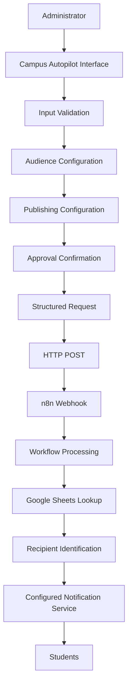
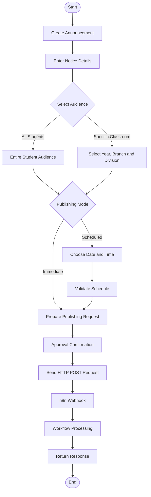
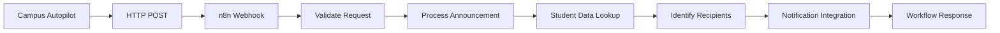

# Campus Autopilot

<div align="center">

### Intelligent Campus Communication & Automation Platform

**Automating Campus Communication. Simplifying Administration.**

[](https://atharva1118.github.io/campus-autopilot-ui/)
[](https://github.com/Atharva1118/campus-autopilot-ui)


A centralized campus announcement platform that connects notice management with workflow automation, helping institutions communicate important updates to the intended students.

</div>

---

## Project Status

| Component | Status |
|---|---|
| Frontend application | Live on GitHub Pages |
| Notice creation interface | Implemented |
| Audience selection | Implemented |
| Publishing and approval interface | Implemented |
| Webhook communication | Implemented in frontend |
| n8n workflow backup | Exported and saved |
| n8n Cloud instance | Trial expired; currently inactive |
| Self-hosted n8n using Docker | Migration pending |
| Backend notification delivery | Pending workflow restoration and testing |

> **Important:** The frontend is publicly accessible, but the backend automation is not currently active. Actual notice delivery requires a working n8n instance, a configured webhook, valid service credentials, and successful end-to-end testing.

## Table of Contents

1. [Overview](#1-overview)
2. [Live Demo](#2-live-demo)
3. [Problem Statement](#3-problem-statement)
4. [Features](#4-features)
5. [How to Use](#5-how-to-use)
6. [Technology Stack](#6-technology-stack)
7. [System Architecture](#7-system-architecture)
8. [Application Workflow](#8-application-workflow)
9. [Project Structure](#9-project-structure)
10. [Getting Started](#10-getting-started)
11. [Deployment](#11-deployment)
12. [n8n Workflow Integration](#12-n8n-workflow-integration)
13. [API Reference](#13-api-reference)
14. [Security Considerations](#14-security-considerations)
15. [Roadmap](#15-roadmap)
16. [Contributing](#16-contributing)
17. [Author](#17-author)

---

## 1. Overview

Campus Autopilot is a web-based campus communication platform designed to simplify how educational institutions create, manage, and distribute announcements.

In traditional academic environments, important updates are often shared through disconnected channels such as messaging groups, notice boards, emails, and word of mouth. This can result in repetitive administrative work, delayed communication, and difficulty reaching specific academic groups.

Campus Autopilot introduces a centralized notice management interface that connects announcement creation with configurable workflow automation.

### How It Works

1. An administrator creates an announcement.
2. The intended audience is selected: all students or a specific classroom.
3. Immediate or scheduled publishing is configured.
4. The announcement is reviewed and approved.
5. The frontend prepares a structured request and sends it to a configured n8n webhook.
6. An active n8n workflow can process the request, identify matching recipients, and execute configured notification actions.

### Project Objectives

- Centralize campus announcement creation.
- Reduce repetitive administrative communication.
- Enable audience segmentation by academic year, branch, and division.
- Support immediate and scheduled publishing.
- Introduce an approval checkpoint before production submission.
- Connect frontend operations with automation workflows.
- Establish a foundation for scalable campus communication.

---

## 2. Live Demo

<div align="center">

### Experience Campus Autopilot

[](https://atharva1118.github.io/campus-autopilot-ui/)

**Live Application:**  
https://atharva1118.github.io/campus-autopilot-ui/

**Source Code:**  
https://github.com/Atharva1118/campus-autopilot-ui

</div>

The application is hosted as a static frontend using GitHub Pages.

The frontend can be explored independently. To enable actual notification delivery, an active n8n workflow and a valid webhook URL must be configured.

**Current backend status:** The original n8n Cloud trial has expired. The exported workflow has been saved for restoration on a self-hosted n8n instance. Backend delivery is therefore not currently available through the live demo.

---

## 3. Problem Statement

Educational institutions regularly communicate academic updates, examination schedules, event announcements, placement information, and important deadlines.

Traditional communication methods introduce several challenges:

| Challenge | Impact |
|---|---|
| Manual notice distribution | Repetitive administrative work |
| Multiple communication channels | Fragmented information |
| Lack of audience segmentation | Students receive irrelevant announcements |
| Manual scheduling | Additional coordination |
| No centralized interface | Difficult notice management |
| No approval checkpoint | Risk of submitting incorrect announcements |

### Our Solution

Campus Autopilot provides a centralized interface with:

- Structured announcement creation.
- Configurable audience targeting.
- Immediate and scheduled publishing options.
- Final approval before submission.
- Webhook-based workflow communication.
- Integration capability with external student data sources.

---

## 4. Features

### 4.1 Notice Creation

- Create announcements with custom titles and descriptions.
- Title field with a 120-character limit.
- Message field with a 5,000-character limit.
- Live character counters.
- Multi-paragraph message support.
- Required-field validation.
- Real-time notice preview.

### 4.2 Intelligent Audience Targeting

Choose the appropriate recipient group.

| Audience | Description |
|---|---|
| All Students | Targets the entire configured student audience. |
| Specific Classroom | Targets students according to academic year, branch, and division. |

Supported academic years:

- First Year (FY)
- Second Year (SY)
- Third Year (TY)
- Fourth Year (Final Year)

Branch and division options depend on the academic configuration.

### 4.3 Flexible Publishing

**Immediate Publishing**
- Submit an announcement for immediate workflow processing.

**Scheduled Publishing**
- Select a future date and time.
- Validate the selected schedule.
- Include publishing preferences in the request.

> Scheduled publishing requires a workflow that supports and correctly processes scheduled requests. The frontend scheduling interface alone does not guarantee automatic future delivery.

### 4.4 Final Approval Safeguard

- Mandatory approval checkbox.
- Explicit production delivery confirmation.
- Review before submitting the announcement.
- Approval validation before submission.

### 4.5 Workflow Automation Interface

- n8n webhook integration.
- HTTP POST communication.
- JSON-based request data.
- Configurable webhook URL.
- Browser-based connection configuration.
- Request response feedback.

### 4.6 Student Data Integration

Google Sheets can be connected through n8n to retrieve student records and identify recipients according to the selected audience.

The actual lookup and notification behavior depends on the workflow configuration and connected service credentials.

---

## 5. How to Use

Follow these steps to create and submit an announcement.

| Step | Action |
|---|---|
| 01 | Open the [Campus Autopilot Live Demo](https://atharva1118.github.io/campus-autopilot-ui/). |
| 02 | Open the Automation Connection panel. |
| 03 | Configure an active n8n webhook URL, if a working backend is available. |
| 04 | Enter the announcement title and message. |
| 05 | Select All Students or Specific Classroom. |
| 06 | Select the academic year, branch, and division if required. |
| 07 | Choose immediate or scheduled publishing. |
| 08 | Review the announcement using the live preview. |
| 09 | Confirm the approval checkbox. |
| 10 | Click Publish Notice to submit the request. |

Use the Clear Form option to reset the announcement form.

> **Note:** Submitting a request to a webhook does not necessarily mean that student notifications have been delivered. Successful delivery depends on the availability and configuration of the backend workflow.

---

## 6. Technology Stack

| Technology | Purpose |
|---|---|
| HTML5 | Frontend structure |
| CSS3 | Styling and responsive interface |
| JavaScript | Application logic and validation |
| n8n | Workflow automation |
| Google Sheets | Configurable student data source |
| Webhooks | Frontend-to-workflow communication |
| JSON | Structured data exchange |
| GitHub Pages | Static frontend hosting |
| Git & GitHub | Version control and collaboration |

### Why This Technology Stack?

**Vanilla JavaScript**

Keeps the application lightweight without requiring a frontend framework or complex build process.

**n8n Automation**

Provides a visual automation environment for connecting external services and processing announcement requests.

**Google Sheets**

Can act as a configurable student data source through automation workflows.

**GitHub Pages**

Enables straightforward hosting of the static frontend directly from the repository.

---

## 7. System Architecture

Campus Autopilot follows a frontend-to-workflow integration architecture.

### High-Level Architecture



### Architecture Components

| Component | Responsibility |
|---|---|
| Administrator | Creates and approves announcements |
| Frontend | Collects input and performs validation |
| Audience Configuration | Defines intended recipients |
| Webhook | Transfers structured request data |
| n8n | Executes configured automation workflows |
| Google Sheets | Can provide student records |
| Notification Service | Handles configured notification distribution |

### Data Flow

1. The administrator creates a notice.
2. JavaScript validates the submitted information.
3. Audience and publishing preferences are configured.
4. The administrator approves the announcement.
5. The frontend sends a request to the configured webhook.
6. An active n8n workflow receives and processes the request.
7. Student information can be retrieved from Google Sheets.
8. Configured notification integrations can handle distribution.

> Recipient lookup and notification delivery depend on the actual workflow configuration. The architecture diagram represents the intended integration flow, not a claim that the backend is currently running.

---

## 8. Application Workflow

The application follows a structured announcement publishing process.



The workflow separates announcement creation, audience selection, approval, and backend processing to make the publishing process structured and manageable.

---

## 9. Project Structure

```text
campus-autopilot-ui/
│
├── index.html
│   └── Main application interface
│
├── style.css
│   └── UI styling and responsive design
│
├── script.js
│   └── Application logic, validation and webhook integration
│
└── README.md
    └── Project documentation
```

The project follows a simple frontend architecture with a clear separation of structure, presentation, and application logic.

The n8n workflow is maintained separately as an exported workflow backup and is not currently part of the deployed frontend repository.

---

## 10. Getting Started

### Prerequisites

- Git installed on your system.
- A modern web browser.
- Visual Studio Code (recommended).
- An active n8n instance only if backend automation is required.

### Step 1: Clone the Repository

```bash
git clone https://github.com/Atharva1118/campus-autopilot-ui.git
```

### Step 2: Navigate to the Project

```bash
cd campus-autopilot-ui
```

### Step 3: Open in Visual Studio Code

```bash
code .
```

### Step 4: Run the Application

Open `index.html` directly in your browser.

Alternatively, install the Live Server extension in Visual Studio Code and select:

**Open with Live Server**

No frontend dependency installation or build command is required for the current implementation.

### Step 5: Configure Backend Automation (Optional)

To enable request processing:

1. Set up an active n8n instance.
2. Import or recreate the saved workflow.
3. Reconfigure the required credentials and integrations.
4. Configure the webhook node.
5. Activate the workflow.
6. Add the new webhook URL in the frontend Automation Connection panel.
7. Test using sample data before enabling real notifications.

---

## 11. Deployment

Campus Autopilot is a static frontend application and can be deployed through GitHub Pages.

### Deployment Steps

1. Push the project to your GitHub repository.
2. Open repository Settings.
3. Navigate to Pages.
4. Under Build and Deployment, select **Deploy from a branch**.
5. Select the `main` branch.
6. Select the `/ (root)` directory.
7. Click Save.
8. Wait for GitHub Pages to complete deployment.

### Live Deployment

https://atharva1118.github.io/campus-autopilot-ui/

The frontend deployment is independent of the n8n backend. Restoring or changing the backend does not require moving the static frontend away from GitHub Pages.

---

## 12. n8n Workflow Integration

Campus Autopilot is designed to communicate with n8n through an HTTP webhook.

### Current Integration Status

The original n8n Cloud trial has expired, and the cloud instance is currently inactive.

The workflow was exported and saved as a backup. Migration to a self-hosted n8n instance using Docker is pending.

Therefore, the following steps describe the intended restoration process rather than a currently active backend deployment.

### Planned Self-Hosted Setup

1. Install Docker and Docker Compose.
2. Set up a self-hosted n8n instance.
3. Access the n8n editor.
4. Import the exported Campus Autopilot workflow.
5. Review and reconnect the required integrations.
6. Configure the Webhook node.
7. Verify the incoming request structure.
8. Test the workflow with sample student records.
9. Configure the notification service.
10. Activate the workflow after successful testing.
11. Copy the production webhook URL.
12. Configure the URL in Campus Autopilot.

### Intended Workflow Architecture



### Possible Workflow Extensions

The n8n workflow can be extended to support:

- Email notifications.
- Student record lookup.
- Audience-based filtering.
- Scheduled delivery.
- Workflow execution logging.
- Additional messaging integrations.

The actual integrations depend on the imported workflow, valid credentials, and successful testing.

---

## 13. API Reference

Campus Autopilot uses HTTP POST requests to communicate with the configured n8n webhook.

### Request Configuration

| Parameter | Value |
|---|---|
| Method | `POST` |
| Content Type | JSON request data |
| Endpoint | Configured n8n webhook URL |
| Data Format | JSON |

### Example Request Payload

The following is an illustrative example of the announcement information that an automation workflow may process.

```json
{
  "title": "Important Academic Announcement",
  "message": "Students are informed about the upcoming academic activity.",
  "audience": {
    "type": "specific",
    "academicYear": "Third Year",
    "branch": "CSE",
    "division": "A"
  },
  "publishing": {
    "mode": "immediate",
    "scheduledDate": "",
    "scheduledTime": ""
  },
  "source": "Campus Autopilot"
}
```

> This example illustrates the information used by the application. It is not a guaranteed copy of the exact runtime request. The actual request keys and values must be verified against `script.js` before configuring the n8n workflow.

### Expected Workflow Processing

An appropriately configured n8n workflow can:

- Validate announcement details.
- Identify the intended audience.
- Retrieve matching student records.
- Execute configured notification actions.
- Return a workflow response.

A successful HTTP response indicates that the endpoint responded; it does not independently prove that every intended student received the notification.

---

## 14. Security Considerations

Security and reliability are essential for applications handling institutional communication and student information.

### Recommended Security Practices

- Validate incoming webhook requests.
- Implement authentication for administrative access.
- Avoid exposing private API credentials in frontend code.
- Restrict access to student information.
- Configure appropriate CORS policies.
- Protect webhook endpoints against unauthorized requests.
- Maintain workflow execution logs.
- Verify notification delivery independently of webhook acceptance.
- Use sample records during development and testing.

### Important Security Notes

**Webhook URL Storage**

The frontend stores the configured webhook URL in browser local storage. Local storage is not a secure secret store, and frontend configuration can be inspected by users.

**Backend Credentials**

Private credentials for Gmail, Google Sheets, or other integrations should be stored securely in n8n or a protected backend, never directly in frontend JavaScript.

**Production Delivery**

Test the workflow using sample student data and your own email address before enabling notifications for real students.

For a production institutional deployment, an authenticated backend and role-based access control should be implemented.

---

## 15. Roadmap

### Implemented Frontend Features

- [x] Notice creation interface
- [x] Title and message fields
- [x] Live character counters
- [x] Real-time notice preview
- [x] Audience selection
- [x] Academic year selection
- [x] Branch and division selection
- [x] Immediate publishing option
- [x] Scheduled publishing interface
- [x] Date and time validation
- [x] Final approval confirmation
- [x] Webhook configuration interface
- [x] HTTP request integration
- [x] GitHub Pages deployment

### Backend Restoration

- [x] Export and save n8n workflow backup
- [ ] Set up self-hosted n8n using Docker
- [ ] Import the saved workflow
- [ ] Reconnect external service credentials
- [ ] Configure a new production webhook
- [ ] Test student data lookup
- [ ] Test notification delivery
- [ ] Verify scheduled publishing
- [ ] Restore end-to-end automation

### Future Enhancements

- [ ] Secure administrator authentication
- [ ] Role-based access management
- [ ] Centralized backend and database
- [ ] Notice history and editing
- [ ] Notification delivery tracking
- [ ] Email notification integration
- [ ] Mobile notification integration
- [ ] Document and PDF attachments
- [ ] Analytics dashboard
- [ ] Administrative audit logs
- [ ] Student-specific notifications

### Long-Term Vision

| Area | Planned Development |
|---|---|
| Centralized Dashboard | Unified campus communication management |
| Smart Audience Management | Advanced student segmentation |
| Multi-Channel Communication | Email and messaging integrations |
| Analytics | Announcement and delivery insights |
| Administration | Secure authentication and authorization |

---

## 16. Contributing

Contributions, suggestions, and improvements are welcome.

### Contribution Guidelines

1. Fork the repository.
2. Create a new feature branch.
3. Implement your changes.
4. Test the updated functionality.
5. Submit a pull request with a clear description.

For major changes, please open an issue first to discuss your proposal.

---

## 17. Author

<div align="center">

### Atharva Ghorpade

**B.Tech Computer Science & Engineering**

[](https://github.com/Atharva1118)

[](https://www.linkedin.com/in/atharva-ghorpade-45842732b/)

**Project Links**

[Live Application](https://atharva1118.github.io/campus-autopilot-ui/) · [GitHub Repository](https://github.com/Atharva1118/campus-autopilot-ui)

</div>

---

<div align="center">

### CAMPUS AUTOPILOT

**Intelligent Automation for a Connected Campus.**

Designed and developed to simplify institutional communication through technology.

[⬆ Back to Top](#campus-autopilot)

</div>
