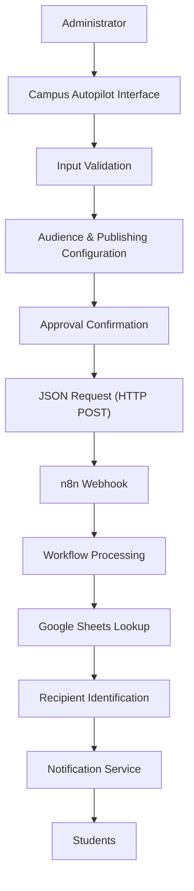
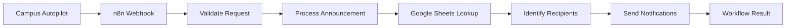

<div align="center">

# Campus Autopilot

**Intelligent Campus Communication & Automation Platform**

*Automating Campus Communication. Simplifying Administration.*

[


](https://atharva1118.github.io/campus-autopilot-ui/)


A centralized campus announcement interface that connects notice management with workflow automation, so the right update reaches the right students at the right time.

[**Try the Live Demo**](https://atharva1118.github.io/campus-autopilot-ui/) •
[Features](#features) •
[Architecture](#architecture) •
[Getting Started](#getting-started)

</div>

---

## Table of Contents

- [Overview](#overview)
- [Live Demo](#live-demo)
- [Problem Statement](#problem-statement)
- [Features](#features)
- [How to Use the Application](#how-to-use-the-application)
- [Tech Stack](#tech-stack)
- [Architecture](#architecture)
- [Application Workflow](#application-workflow)
- [Project Structure](#project-structure)
- [Getting Started](#getting-started)
- [Deployment (GitHub Pages)](#deployment-github-pages)
- [n8n Integration](#n8n-integration)
- [API Reference](#api-reference)
- [Security Notes](#security-notes)
- [Roadmap](#roadmap)
- [Contributing](#contributing)
- [Author](#author)

---

## Overview

Campus Autopilot is a web-based campus communication platform that simplifies how educational institutions create, manage, and distribute announcements.

In most colleges, notices travel through disconnected channels such as WhatsApp groups, notice boards, emails, and word of mouth. This causes repeated manual work, delayed updates, and difficulty reaching a specific class or branch.

Campus Autopilot replaces that with a single notice-upload workspace. An administrator writes a notice, chooses who should receive it (the whole college or one specific classroom), decides whether to publish now or later, and gives a final approval. The application then sends a structured JSON request to an **n8n webhook**, which handles recipient lookup (for example from Google Sheets) and delivery through whichever notification channels the workflow is configured for.

The frontend is intentionally lightweight: plain HTML, CSS, and JavaScript with no framework and no build step. All the heavy lifting of delivery lives in the n8n workflow, so the same interface can drive email, messaging, or any other integration without code changes.

**Objectives**

- Centralize campus announcement creation in one place
- Reduce repetitive administrative communication
- Enable academic audience segmentation by year, branch, and division
- Support both immediate and scheduled publishing
- Add a deliberate approval step before anything reaches real students
- Connect the frontend to automation workflows through webhooks
- Provide a foundation for scalable campus communication

---

## Live Demo

The application is deployed with GitHub Pages and can be tried directly in the browser:

**https://atharva1118.github.io/campus-autopilot-ui/**

> The demo is a static frontend. To actually deliver notices, paste your own n8n webhook URL into the **Automation connection** panel. Without a webhook configured, nothing is sent anywhere. Use a test workflow, not a production one, while experimenting.

---

## Problem Statement

Educational institutions constantly share academic updates, event announcements, examination schedules, placement information, and urgent notices. Conventional methods cause several problems:

| Challenge | Impact |
|---|---|
| Manual notice distribution | Repetitive administrative work |
| Multiple communication channels | Fragmented information |
| No audience segmentation | Students receive irrelevant announcements |
| Manual scheduling | Additional coordination effort |
| No centralized management | Difficult notice tracking |
| No approval checkpoint | Risk of sending incorrect notices |

**Our approach:** one interface with configurable audience targeting, optional scheduling, an explicit approval step, and a structured automation workflow, instead of coordinating every announcement by hand.

---

## Features

### Notice Creation
- Notice title with a **120-character** limit and live counter
- Notice message with a **5,000-character** limit and live counter
- Support for multi-paragraph messages
- Required-field validation before submission
- **Live preview card** that updates as you type, showing the title, message, and selected audience

### Audience Targeting
- **All Students:** send to every student in the college
- **Specific Classroom:** target by
  - **Academic year:** First Year (FY), Second Year (SY), Third Year (TY), Fourth Year (Final Year)
  - **Branch:** engineering branch selection
  - **Division:** dependent on the chosen year and branch

### Flexible Publishing
- **Publish immediately** by leaving the schedule empty
- **Schedule for later** by choosing a date and time
- Validation that both date and time are provided when scheduling

### Final Approval Safeguard
- A required confirmation checkbox: *"I approve this notice for production delivery"*
- A clear warning that production mode can send notices to real student email addresses
- A status indicator that shows the notice is *Pending* until approved

### Workflow Automation
- n8n webhook integration over HTTP POST
- JSON-based data exchange
- Configurable webhook URL saved in the browser
- Request processing and response feedback in the interface

### Student Data Integration
Google Sheets can be connected through n8n to retrieve student records and identify recipients that match the selected audience criteria.

### Interface
- Dashboard-style workspace layout with a sidebar and top bar
- Three clearly numbered steps: notice details, audience, schedule
- Responsive design for different screen sizes

---

## How to Use the Application

1. **Open the app** at the [live demo](https://atharva1118.github.io/campus-autopilot-ui/).
2. **Connect automation:** in the *Automation connection* panel, paste your n8n production webhook URL and click **Save connection**.
3. **Step 01, Notice details:** enter a title and message and watch the live preview update.
4. **Step 02, Audience:** choose *All Students*, or choose *Specific Classroom* and select year, branch, and division.
5. **Step 03, Schedule:** leave date and time empty to publish now, or set both to publish later.
6. **Final approval:** review the details and tick the approval checkbox.
7. **Publish:** click **Publish notice**. The request is sent to your n8n webhook, and the workflow controls the actual delivery.

Use **Clear form** to reset everything at any time.

---

## Tech Stack

| Technology | Role |
|---|---|
| HTML5 | Frontend structure |
| CSS3 | Styling and responsive interface |
| JavaScript (Vanilla) | Application logic and validation |
| n8n | Workflow automation |
| Google Sheets | Student data source |
| Webhooks | Frontend-to-workflow communication |
| JSON | Data exchange format |
| GitHub Pages | Static hosting and live demo |
| Git & GitHub | Version control |

**Technology decisions**

- **Vanilla JavaScript:** keeps the frontend lightweight, with no framework or build configuration, and makes it trivial to host on GitHub Pages.
- **n8n:** a visual automation environment for connecting external services and processing announcement requests.
- **Google Sheets:** an easily editable, configurable source of student information.
- **GitHub Pages:** free static hosting that deploys straight from the repository.

---

## Architecture

Campus Autopilot follows a frontend-to-workflow architecture. The frontend only collects, validates, and forwards data. Recipient lookup and delivery are handled by n8n.



| Component | Responsibility |
|---|---|
| Administrator | Creates, configures, and approves announcements |
| Frontend | Collects and validates input, previews the notice |
| Audience Configuration | Defines intended recipients |
| Webhook | Transfers structured data |
| n8n | Executes the configured automation |
| Google Sheets | Provides student records |
| Notification Service | Handles distribution (for example email) |

**Data flow**

1. The administrator writes a notice.
2. The frontend validates the input and updates the live preview.
3. Audience and schedule preferences are configured.
4. The administrator approves the notice.
5. The app sends a JSON request to the configured webhook.
6. n8n receives the request and processes the announcement.
7. Student records are retrieved from Google Sheets.
8. Configured notification integrations deliver the notice.

> Actual recipient identification and delivery depend on the deployed n8n workflow.

---

## Application Workflow


---

## Project Structure

```text
campus-autopilot-ui/
├── index.html    # Main application interface
├── style.css     # Styling and responsive design
├── script.js     # Application logic, validation, and webhook integration
└── README.md     # Project documentation
```

Structure, presentation, and logic are kept in separate files for clarity.

---

## Getting Started

### Prerequisites

- Git
- A modern web browser
- Visual Studio Code (recommended)
- An n8n Cloud or self-hosted instance (needed to deliver notices)

### Installation

```bash
git clone https://github.com/Atharva1118/campus-autopilot-ui.git
cd campus-autopilot-ui
code .
```

### Run Locally

Open `index.html` directly in a browser, or install the **Live Server** extension in VS Code and choose **Open with Live Server**.

No dependency installation or build command is required.

---

## Deployment (GitHub Pages)

The project is a static site, so it deploys to GitHub Pages without any build step.

1. Push the project to a GitHub repository.
2. Open **Settings → Pages**.
3. Under **Build and deployment**, set **Source** to *Deploy from a branch*.
4. Select the `main` branch and the `/ (root)` folder, then save.
5. After a minute or two, the site is live at:

```text
https://<your-username>.github.io/campus-autopilot-ui/
```

Current deployment: **https://atharva1118.github.io/campus-autopilot-ui/**

---

## n8n Integration

1. Open your n8n workspace and create a new workflow.
2. Add a **Webhook** node and set the HTTP method to `POST`.
3. Configure the expected request data.
4. Copy the **production** webhook URL.
5. Paste it into the *Automation connection* panel and click **Save connection**.
6. Activate the n8n workflow.
7. Send a test announcement.



The workflow can be extended with additional n8n nodes for email, messaging, and other notification services. It can also handle scheduled delivery, for example with a Wait node.

---

## API Reference

| Property | Value |
|---|---|
| Method | `POST` |
| Content-Type | `application/json` |
| Endpoint | Your n8n webhook URL |

### Example Payload

```json
{
  "title": "Important Academic Announcement",
  "message": "Students are informed about the upcoming academic activity.",
  "recipientType": "specific",
  "audience": "classroom",
  "academicYear": "Third Year",
  "branch": "CSE",
  "division": "A",
  "publishMode": "immediate",
  "scheduledDate": "",
  "scheduledTime": "",
  "source": "Campus Autopilot"
}
```

> This is an illustrative example. The actual payload should match the fields generated by the current frontend in `script.js`.

The n8n workflow can use this data to validate the announcement, determine the audience, retrieve matching students, run notification workflows, and return an execution response.

---

## Security Notes

Campus systems may handle student information, so security should be considered from the start.

- Validate incoming webhook requests
- Add authentication for administrative access
- Never expose private API credentials in frontend code
- Restrict access to student data
- Configure appropriate CORS policies
- Protect webhook endpoints from unauthorized requests
- Keep execution logs for troubleshooting
- Verify notification delivery independently of webhook acceptance

> ⚠️ **The webhook URL is saved in your browser's local storage, which is not a secure secret.** Anyone with access to the device or the URL could trigger your workflow. Do not use shared devices with a real production URL. Production deployments should route requests through an authenticated backend.

> ⚠️ **Production mode can email real students.** Test with a sample Google Sheet containing only your own address before connecting real data.

---

## Roadmap

### Implemented
- [x] Notice creation interface with title and message fields
- [x] Live character counters and notice preview
- [x] Audience, academic year, branch, and division selection
- [x] Immediate and scheduled publishing with date/time validation
- [x] Final approval confirmation before publishing
- [x] Webhook configuration and HTTP request integration
- [x] GitHub Pages deployment

### Planned
- [ ] Secure administrator authentication
- [ ] Role-based access management
- [ ] Centralized backend and database
- [ ] Notice history and editing
- [ ] Notification delivery tracking
- [ ] Email and mobile notification integration
- [ ] Document and PDF attachments
- [ ] Analytics dashboard
- [ ] Audit logs
- [ ] Student-specific notifications

### Long-Term Vision

- **Centralized dashboard:** one place to manage all institutional communication
- **Smart audience management:** richer segmentation with configurable filters
- **Multi-channel notifications:** email, messaging platforms, and more
- **Analytics and reporting:** insight into announcement activity and delivery
- **Secure administration:** authentication, authorization, and activity tracking

---

## Contributing

Contributions and suggestions are welcome.

1. Fork the repository
2. Create a feature branch
3. Make and test your changes
4. Submit a pull request with a clear description

For major changes, please open an issue first to discuss your proposal.

---

## Author

**Atharva Ghorpade**
B.Tech Computer Science and Engineering

[


](https://github.com/Atharva1118)
[


](https://www.linkedin.com/in/atharva-ghorpade-45842732b/)

---

<div align="center">

**CAMPUS AUTOPILOT**
*Intelligent Automation for a Connected Campus.*

[Live Demo](https://atharva1118.github.io/campus-autopilot-ui/) • [Repository](https://github.com/Atharva1118/campus-autopilot-ui)

</div>
